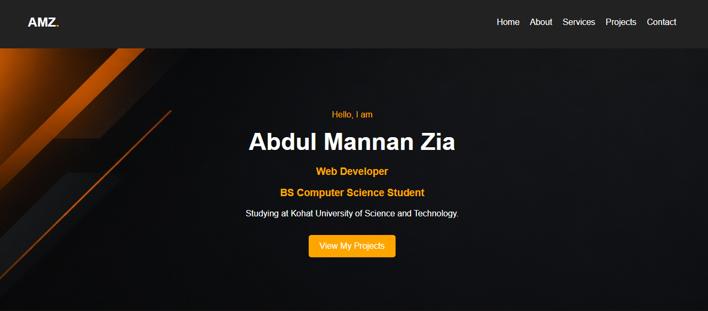

  

Abdul Mannan Zia — Personal Portfolio Website

Welcome to my personal portfolio website! 👋

I am Abdul Mannan Zia, a BS Computer Science student at Kohat University of Science and Technology (KUST) and an aspiring web developer passionate about web development, C# programming, and Artificial Intelligence.

🌐 About the Project

This portfolio website is built using HTML and CSS to showcase my skills, services, projects, and contact information. It features a modern dark theme with orange accents.

✨ Features

🏠 Home section

👨‍💻 About me section

🛠️ Services section

📂 Projects showcase

📧 Contact information

📱 Responsive design for different screen sizes

🎨 Dark background with orange accents

🛠️ Technologies Used

HTML5

CSS3

🚀 My Projects

1. AI Website Tool Finders

An AI-focused website designed to help users discover useful AI tools.

🔗 View Project

2. Diabetes Risk Estimator AI

An AI-based project designed to estimate diabetes risk using relevant health information.

🔗 View Project on GitHub

💻 How to Run the Project

Clone this repository:

git clone https://github.com/abdulmannanzia/abdul-mannan-portfolio.git

Open the project folder.

Open index.html in your web browser.

No additional installation is required.

📬 Contact Me

Email: abdulmannanzia@outlook.com

GitHub: abdulmannanzia

📄 License

This project is open-source and available for learning and personal use.

⭐ Thank you for visiting my portfolio repository!
